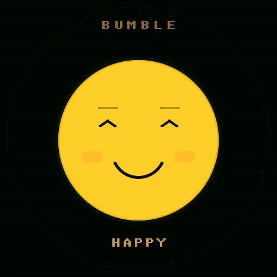
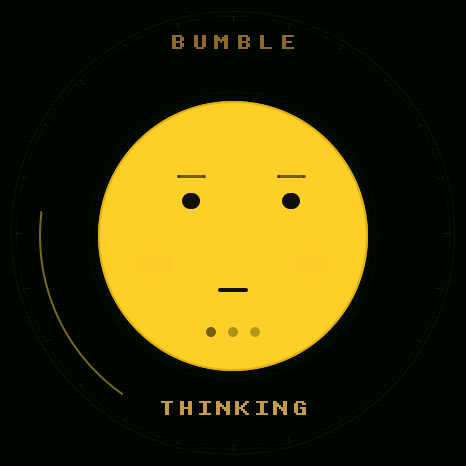
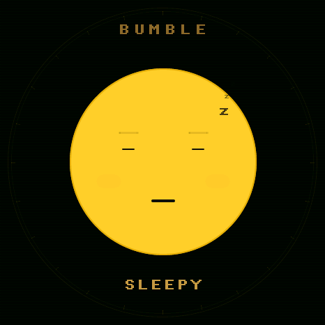
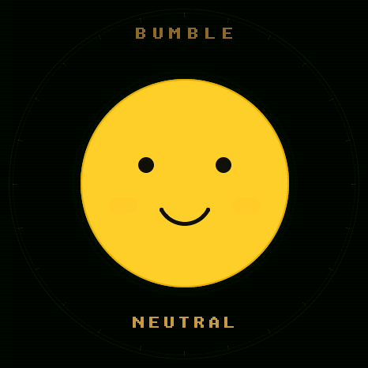
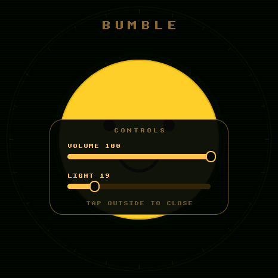

# Bumble

**A tiny, offline voice companion for the Waveshare ESP32-S3 1.75" round AMOLED.**

Say **"Hey Bumble"**, ask it something, and a big yellow smiley answers out loud.
No cloud, no WiFi, no account. Speech recognition, speech synthesis, an alarm clock
and the face all run on the board.

<p align="center">
  
  
  
</p>

<p align="center">
  
  
</p>

## What it does

| | |
| --- | --- |
| **Wake word** | "Hey Bumble" or just "Bumble". Other speech is ignored. |
| **Speech in** | BabyTalk's 4-bit Citrinet-256, 6 MB, read in place from flash. |
| **Speech out** | sanoTTS `nano` voice, 24 kHz, ~0.3x real time. |
| **Face** | Ten emotions on a shaded yellow sphere, with catchlights, rim light, breathing, blinking, glances, winks, yawns and a talking mouth. |
| **Touch** | Tap for volume and brightness faders. Settings persist across reboots. |
| **Brain** | Intent rules, memory notes, a mood, and the occasional unprompted remark. |
| **Calculator** | Full expressions, powers, roots, trig, logs, percentages, statistics and standard form. |
| **Spelling** | "How do you spell necessary?" says the letters out loud. |
| **Alarm** | One alarm or timer, optional daily repeat, chime and spoken wake-up. Persisted. |
| **Clock** | PCF85063 RTC. Time and date survive power loss. |

It is a small rule engine, not a language model. The illusion comes from the wake
word, the memory, the timing, and the face.

## Quick start

### You need

- Waveshare **ESP32-S3-Touch-AMOLED-1.75** (16 MB flash, 8 MB PSRAM)
- ESP-IDF **v5.5.x**
- Python 3 and [`uv`](https://docs.astral.sh/uv/)
- A speaker on the MX1.25 connector (optional, but it is a talking face)

### Build

```bash
git clone https://github.com/mjbeswick/bumble.git
cd bumble
./scripts/fetch_deps.sh          # BabyTalk + sanoTTS at pinned commits
. ~/esp/esp-idf/export.sh
idf.py set-target esp32s3
idf.py build
```

`fetch_deps.sh` clones into `third_party/` (git-ignored). The build then runs
`scripts/prepare_sanotts.py`, a portable version of BabyTalk's `prepare.sh` that
does not need GNU sed.

Without sanoTTS the firmware still builds and listens, but cannot speak.

### Flash

`scripts/flash.sh` finds the board by **MAC address**, checks the chip and flash
size, then writes. Edit `WANT_MAC` for your board, or pass it in the environment:

```bash
WANT_MAC=80:45:6b:33:cf:a8 ./scripts/flash.sh      # app, partition table, model
./scripts/flash.sh app                             # app only
```

| offset | image |
| --- | --- |
| `0x0` | bootloader (DIO) |
| `0x8000` | partition table: 5 MB app, 6 MB model, 5 MB storage |
| `0x10000` | `build/bumble.bin` |
| `0x510000` | `third_party/babytalk/models/citrinet256_int4.mmrt` |

For a noisy room, flash `citrinet256_noisy_int4.mmrt` instead.

## Talking to it

Wake it first. If you say only the wake word it answers "Yes?" and listens for the
next sentence for six seconds.

| Say | Get |
| --- | --- |
| "Hey Bumble, what time is it?" | The time, from the RTC. |
| "Hey Bumble, what is the date?" | "Today is Saturday, October 17, 2026." |
| "Hey Bumble, set an alarm for 7:30." | Alarm, next occurrence. |
| "Hey Bumble, set an alarm for 7:30 every day." | Daily alarm. |
| "Hey Bumble, set a timer for 10 minutes." | Timer. |
| "Hey Bumble, what alarm do I have?" | Spoken alarm or timer state. |
| "Hey Bumble, cancel the alarm." | Cancels it. |
| "Hey Bumble, what is twelve times four?" | "That is 48." |
| "Hey Bumble, what is the square root of two?" | "That is 1.414213562." |
| "Hey Bumble, what is 2 to the power of 100?" | Spoken standard form. |
| "Hey Bumble, what is sine of 30?" | "That is 0.5." |
| "Hey Bumble, increase 80 by 15 percent." | "That is 92." |
| "Hey Bumble, mean of 3 4 5 6." | "That is 4.5." |
| "Hey Bumble, how do you spell necessary?" | "Necessary is spelled en, ee, see..." |
| "Hey Bumble, remember that the spare key is in the drawer." | Stored in NVS. |
| "Hey Bumble, what do you remember?" | Reads the notes back. |
| "Hey Bumble, how many times have we talked?" | Conversation count. |
| "Hey Bumble, tell me a joke." | A joke. |

## Maths

GCSE-friendly, and spoken rather than typed.

- **Arithmetic**: `+ - * /`, precedence, brackets, negative numbers.
- **Powers and roots**: `2 ^ 10`, `3 squared`, `2 cubed`, `square root of 2`, `cube root of 27`.
- **Percentages**: `15% of 200`, `increase 80 by 15 percent`, `decrease 80 by 15%`.
- **Trigonometry**: `sin 30`, `cosine of 60`, `tan 45`, inverses, degrees by default.
- **Logs**: `log 1000` is base 10, `ln 100` is natural.
- **Factorials**: `5!`, `5 factorial`.
- **Constants**: `pi`, `e`.
- **Fractions**: `3 over 4 plus 1 over 2`. Clean fractions are spoken as well as
  the decimal: "1.25, or 1 and 1 over 4".
- **Rounding**: `round 3.14159 to 2 decimal places`, `round 1234 to 3 significant figures`,
  `round 456 to the nearest 100`.
- **Bounds**: `upper bound of 3.4 to 1 decimal place`, `lower bound`, `error interval`.
- **Ratio**: `share 120 in the ratio 2 3`, `simplify the ratio 12 18`.
- **Number theory**: `hcf of 12 and 18`, `lcm of 4 and 6`, `prime factors of 84`,
  `is 17 prime`.
- **Units**: `5 km in miles`, `20 c to f`, `3 hours in minutes`, `2.5 kg in pounds`,
  `10 inches in cm`.
- **Statistics**: `mean of 3 4 5 6`, `median of ...`, `mode of ...`, `range of ...`.
- **Quartiles**: `interquartile range of 3 1 4 2 5 6 7`, `quartiles of ...`.
- **Probability**: `probability of 3 heads in 5 flips`, `probability of rolling a 6`.
- **Quadratic**: `quadratic 1 5 6` means x squared plus 5x plus 6 equals zero.
- **Simultaneous**: `simultaneous 2 3 12 1 -1 1` means 2x+3y=12 and x-y=1.
- **Sequences**: `nth term of 3 7 11`, `next term of 2 6 18`.
- **Shapes**: `area of a circle radius 5`, `circumference of a circle diameter 10`,
  `area of a triangle base 6 height 4`, `volume of a cylinder radius 3 height 5`,
  `volume of a sphere radius 3`.
- **Sine and cosine rules**: `sine rule 7 30 40`, `cosine rule 5 7 60`.
- **Surds**: `simplify root 72` gives "6 root 2".
- **Pythagoras**: `hypotenuse 3 4` or `pythagoras 6 8`.
- **Standard form**: `write 320000 in standard form`, `write 0.00042 in standard form`.
  Results at 1e10 and above are spoken as "X times ten to the power of N".
- **Big numbers**: double precision, so around 15 significant digits.

Trigonometry uses degrees unless the sentence says "radians". Only real numbers are
supported: `sqrt -1` gets a polite refusal rather than an imaginary one.

## Touch

Tap anywhere: two faders appear.

- **VOLUME** 0-100, applied immediately.
- **LIGHT** 15-100, applied immediately.
- Drag a fader, tap outside to close.
- Both values are saved to NVS and restored at boot.

## Development console

Connect at 115200 baud on the USB Serial/JTAG port.

```text
help                     this list
shot                     dump the screen as raw RGB565 (scripts/shot.py)
math <sum>               evaluate a sum and speak the answer
panel                    open the controls
rec                      record 4 seconds and transcribe
think <text>             run text through the brain and speak the reply
say <text>               speak a line
hold <0-9>               freeze an emotion (0 neutral, 1 happy, 4 thinking,
                         7 sleepy, 8 surprised, ...). hold -1 resumes.
emo <0-9>                set an emotion briefly
vol <0-100>              set and save volume
lum <15-100>             set and save brightness
info                     heaps, model size, cache
```

Screenshots:

```bash
uv run --with pyserial --with pillow scripts/shot.py shot.png
```

## How it works

```
ES7210 mic ── 16 kHz ── VAD ── Citrinet-256 (MMRT, both cores) ── text
                                                                  │
                                                       "Bumble" in the text?
                                                                  │
                                                             local brain
                                                                  │
ES8311 speaker ← 24 kHz ← sanoTTS nano voice ←────────────────────┘
                                                                  │
                                                LVGL vector smiley on CO5300
```

- `main/moji_face.c` is the whole face in one LVGL draw callback: circles, lines,
  arcs, no images.
- `main/ui.c` is the layout, the touch faders, and the saved settings.
- `main/brain.c` holds the intents, arithmetic, notes, mood and alarm grammar.
- `main/alarm.c` is the one-shot/daily alarm on the RTC and NVS.
- `main/audio.c` drives the shared I2S bus: ES7210 in, ES8311 out.
- `main/display.c` brings up the CO5300 panel and the CST9217 touch.

Speech in and speech out take turns on one 84 KB internal SRAM arena. The face
buffers live in PSRAM.

### Budget

| | |
| --- | --- |
| app image | ~2.9 MB |
| speech model | 6.0 MB |
| internal RAM free after init | ~90-140 KB |
| PSRAM free | ~7.8 MB |
| transcribe 2 s | ~0.6 s |
| synthesise 2 s of speech | ~0.7 s |

## Project layout

```
main/          firmware: face, brain, alarm, audio, display, console
scripts/       fetch_deps, flash, prepare_sanotts, shot
docs/          screenshots
third_party/   fetched: BabyTalk components, sanoTTS (git-ignored)
```

## Troubleshooting

**No serial port, or the port keeps changing.** USB Serial/JTAG renumbers across
resets. `flash.sh` scans all `/dev/cu.usbmodem*` for the MAC. For other tools, set
`PORT`.

**It answers the television.** Require the wake word; say "Hey Bumble". The CTC
phrase score can be tightened in `app_main.c` (`r.score > -12`).

**The time is wrong.** The RTC is seeded from the build timestamp on first boot.
Use the console or set it over I2C.

**The face stops updating.** Use `hold <n>` to isolate an emotion, `hold -1` to
resume. That narrows it to a shape or a transition.

## Limits

- English, one speaker, and it transcribes after you stop talking.
- Speaker and microphone share one I2S bus, so it cannot listen while talking.
- One alarm at a time. Arithmetic handles two operands.
- Three memory notes, not a diary.
- Firmware built with sanoTTS should be treated as GPL-3.0; see BabyTalk's
  `components/sanotts/LICENSES.md`. This project's own code is MIT.

## Credits

Built on [BabyTalk](https://github.com/tlack/babytalk) by Thomas Lackner (MIT).
Speech models are NVIDIA Citrinet-256 conversions (CC-BY-4.0). The voice is
[sanoTTS](https://github.com/Ampixa/sanoTTS). Display and touch use Espressif's
`esp_lcd` and the Waveshare BSP. The face, brain and UI are original.

MIT licensed. See [LICENSE](LICENSE).
